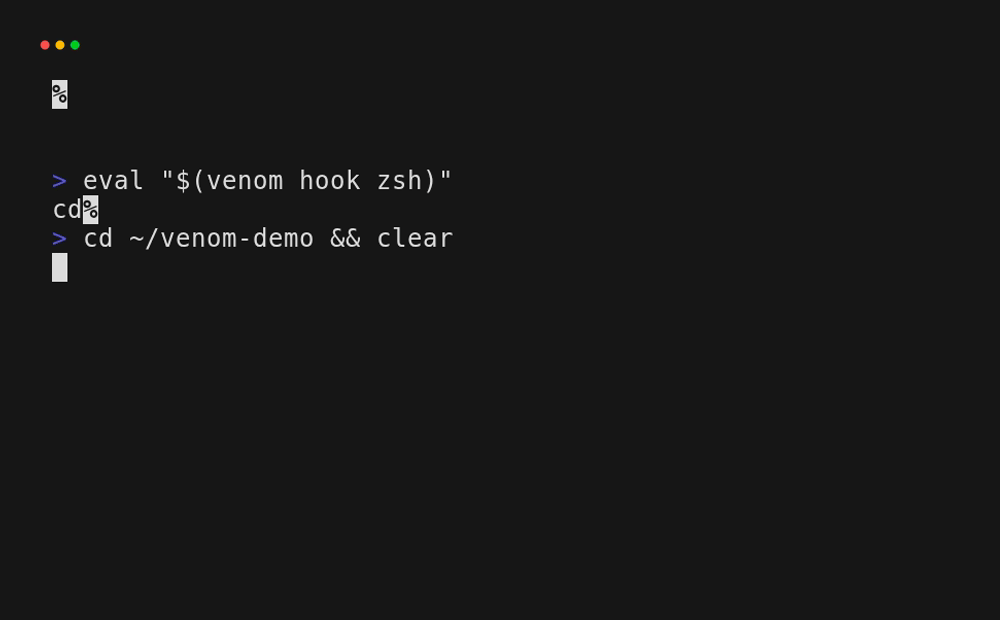

<div align="center">

# venom

### Automatic project environments for Linux<br>without automatically executing project code.

[Demo](#demo) · [Install](#install) · [Getting started](#getting-started) · [Configuration](#configuration) · [Security](#security)

[](https://github.com/SnakePilot10/venom/releases/latest)
[](https://github.com/SnakePilot10/venom/actions/workflows/ci.yml)
[](https://go.dev/)
[](LICENSE)

</div>

Venom detects project environments and updates the current shell automatically.
It supports Bash and Zsh and does not source project activation scripts.

## Demo

<p align="center">
  
</p>

The reproducible source is [`docs/demo/venom.tape`](docs/demo/venom.tape). The
individual detection frame is available as
[`docs/demo/venom-detect.png`](docs/demo/venom-detect.png).

## Install

### Prebuilt binaries

Download the archive for your machine from the [latest release][releases]. The
current release provides Linux x86_64 and Linux ARM64 builds.

```sh
# Linux x86_64
curl -fsSL https://github.com/SnakePilot10/venom/releases/latest/download/venom-linux-amd64.tar.gz | tar -xz
sudo install venom-linux-amd64/venom /usr/local/bin/venom
```

`SHA256SUMS` is published alongside every release archive.

### With Go

```sh
go install github.com/SnakePilot10/venom/cmd/venom@latest
```

### Build from source

```sh
git clone https://github.com/SnakePilot10/venom.git
cd venom
go build -o venom ./cmd/venom
```

## Getting started

After [installing Venom](#install):

1. Load the hook in the current shell and add the same line to `~/.zshrc` or
   `~/.bashrc` for future sessions:

   ```sh
   # zsh
   eval "$(venom hook zsh)"

   # bash
   eval "$(venom hook bash)"
   ```

2. Verify the installation:

   ```sh
   venom doctor
   ```

3. Enter a project. Venom detects its environment and updates the shell:

   ```sh
   cd ~/Projects/my-app
   venom status
   ```

   ```text
   venom  active
     project        ~/Projects/my-app
     stack          Python
     config         none
     venv           .venv
   ```

4. Inspect what Venom found and would apply:

   ```sh
   venom detect
   ```

   `status` shows what is active. `detect` shows what was found and the
   resulting environment plan.

5. Optionally add project-specific values with [`.venom.toml`](#configuration):

   ```toml
   [env]
   APP_ENV = "development"

   [path]
   prepend = ["tools/bin"]
   ```

The hook uses Venom's absolute executable path and refreshes only when the
working directory changes.

## Usage

### Status

```text
venom  active
  project        ~/Projects/app
  stack          Node · Python
  config         .venom.toml
  venv           .venv

  path
    + .venv/bin
    + node_modules/.bin
```

### Doctor

```text
venom doctor
  ✓ version    v0.1.1
  ✓ binary     ~/.local/bin/venom
  ✓ PATH       resolves correctly
  ✓ shell      zsh
  ✓ project    ~/Projects/app
  ✓ hook       active
  ✓ config     .venom.toml

  Everything looks healthy.
```

### Commands

```text
venom status                 Show the current environment
venom detect [dir]           Inspect a project
venom doctor                 Diagnose your setup
venom version                Show the installed version
venom init zsh|bash          Print the shell setup command
venom hook zsh|bash          Generate the shell hook
venom export zsh|bash [dir]  Generate environment changes
```

Human-facing commands support `--color=auto|always|never`. `NO_COLOR` and
`TERM=dumb` disable automatic color. `export`, `hook`, and `init` never add
presentation output because their output is consumed by the shell.

## Supported environments

- Python: `.venv/`, `venv/`, `env/`, `pyproject.toml`, `uv.lock`, `requirements.txt`, `requirements-dev.txt`, `Pipfile`, `Pipfile.lock`, `poetry.lock`
- Node.js: `package.json` and `node_modules/.bin`
- Go: `go.mod` and a project `bin/` directory
- Rust: `Cargo.toml`, `target/debug`, `target/release`
- PHP Composer: `composer.json`, `vendor/bin`
- Generic: `bin/`

The project root is selected using strong markers such as `.git`, `.venom.toml`,
`go.mod`, `package.json`, or `pyproject.toml`. Root markers determine where a
project starts; environment detectors determine whether there is something to
activate. A Git repository with no recognized environment remains inactive.

## Configuration

Optional `.venom.toml` files support literal environment values and PATH
directories. Paths are relative to the project root unless absolute.

```toml
[env]
APP_ENV = "development"

[path]
prepend = [
  "tools/bin",
  "scripts"
]
```

`.venom.toml` is declarative and does not support command execution.

Reserved: `PATH`, `VIRTUAL_ENV`, and `VENOM_*`.

## Security

Venom treats project files as untrusted input. It:

- does not source `.venv/bin/activate`;
- does not execute `.envrc` or project commands;
- uses declarative configuration only;
- protects its reserved `VENOM_*` state variables;
- resolves its own executable for shell hooks;
- removes only the PATH and `VIRTUAL_ENV` state it manages.

Shell paths are single-quoted before being printed, so unusual directory names
cannot inject shell code. See [SECURITY.md](SECURITY.md) to report a suspected
vulnerability privately.

## How Venom works

<details>
<summary>Show the architecture</summary>

```text
directory
    |
    v
root detection
    |
    v
environment detection
    |
    v
`.venom.toml`
    |
    v
environment plan
    |
    v
shell export
```

Detection and planning are separate from shell mutation; shell commands apply
only the resulting exports and PATH changes.

</details>

## Contributing

See [CONTRIBUTING.md](CONTRIBUTING.md) for development setup, checks, design
principles, and pull request guidance.

## Status

Venom is in early development and looking for real-world Linux testing. Bug
reports, edge cases, and feedback are welcome.

## License

Venom is released under the [MIT License](LICENSE).

[releases]: https://github.com/SnakePilot10/venom/releases/latest
